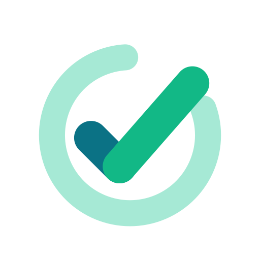

<p align="center">
  
</p>

<h1 align="center">Klart</h1>

<p align="center">
  <strong>Plan your day, get it done, and keep your data where you want it.</strong>
</p>

<p align="center">
  <a href="https://klart.madebyhancock.com/app/"><strong>👉 Open Klart</strong></a>
</p>

<p align="center">
  <a href="https://github.com/Pettor/app-klart/blob/main/LICENSE"></a>
  <a href="../../actions/workflows/main.yml"></a>
  <a href="../../actions/workflows/ci.yml"></a>
</p>

---

Klart is a to-do app built around **My Day**. Each morning you pull in what matters from a ranked list of suggestions, then work through a short, focused list. No accounts, no lock-in: everything Klart knows is plain JSON that you own, sync however you like, and can hand to scripts or AI agents.

## 🚀 Try it now

**[klart.madebyhancock.com/app](https://klart.madebyhancock.com/app/)** is the live application. It runs in any modern browser, installs as an app on your phone or desktop (PWA), and keeps working offline. Your data stays on your device until you choose a way to sync it.

## ✨ Why Klart

### ☀️ My Day, with suggestions that make sense

Start every day with a clean slate. Klart suggests what to pull in, ranked so the important things surface first: **overdue**, **due today**, **left over from yesterday**, **coming up** in the next few days, **related** tasks, and **recently added** ones. Finished tasks stay visible under _Completed_, so you can see what you got done.

### ⚡ Quick add that keeps up with you

Type one line and Klart sorts it out:

```text
Call the dentist #personal @tomorrow ^9:00 ! https://example.com/booking
```

- `#tag` tags the task (a context's tag also files it there)
- `@date` sets the due date
- `^time` sets a reminder
- `!` marks it important
- a `https://…` or `www.…` link is attached to the task

### 🗂️ Contexts for every part of your life

Keep _Personal_, _Work_ and anything else apart, or see everything at once. Switch with a dropdown or <kbd>⌥0</kbd>–<kbd>⌥9</kbd>.

### 🛒 Shopping lists that talk to My Day

Grocery, gift, home and other lists. Grocery items group themselves by store section, and you can write `2x`, `199 kr` or paste a link while adding. Tap the sun on an item to put it in today's My Day; buying it on the list completes the task, and the other way round.

### 🔔 Gentle notifications

Task reminders, a "Plan your day" nudge in the morning, a heads-up about tasks due today without a time, an overdue nudge and an end-of-day wrap-up, all within each context's hours. With several devices, only the one you used last speaks up.

### 🤖 Built for people _and_ agents

Your data is a folder of readable JSON files with an `LLMS.txt` that explains the format. Scripts and LLM agents can read your day from generated views (`views/today.json`, `views/suggestions.json`, `views/shopping.json`) and add tasks by dropping a line of quick-add text into `inbox/`.

### 📱 Everywhere you are

Install it from the browser on your phone or computer, or use the native desktop app for macOS, Windows and Linux. Light and dark themes included.

## 🔄 Sync your way

Klart always saves to the device you're using. To share your data between devices, pick the sync that suits you in **Settings → Sync**. You can mix them: a phone on GitHub sync and a computer on Git sync can share the same repository.

| Sync            | Best for                                          | Works in                                    |
| --------------- | ------------------------------------------------- | ------------------------------------------- |
| **GitHub sync** | Phones, tablets and any browser                   | Every browser and the desktop app           |
| **Folder sync** | OneDrive, iCloud Drive, Dropbox or a local folder | Chrome/Edge on desktop, and the desktop app |
| **Git sync**    | Your own Git remote, with full history            | The desktop app                             |

### 🐙 GitHub sync

Keep your data in a **private GitHub repository** and sync it from anywhere, including your phone. Enter your GitHub username, the repository and a [fine-grained personal access token](https://github.com/settings/personal-access-tokens/new) limited to that one repository with **Contents: Read and write**.

- Every sync is a single commit, so you get a full history of your tasks for free.
- Klart syncs when it opens, every minute while visible, a few seconds after you change something, and when you leave the app with unsaved changes.
- If another device pushed first, Klart pulls, merges and tries again on its own.
- The token is stored only on that device and only private repositories are accepted.

### 📁 Folder sync

Point Klart at a folder, for example inside **OneDrive**, **iCloud Drive** or **Dropbox**, and your cloud drive does the rest. Klart picks up changes from other devices within seconds and writes only the files that changed. In the browser this uses the File System Access API (Chrome and Edge on desktop); the desktop app supports it on every OS.

### 🌿 Git sync

In the desktop app, your data folder can be a Git clone of any remote you like (GitHub, GitLab, your own server). Klart commits your changes, merges what other devices pushed and pushes it back, using your installed `git` and your existing SSH keys or credential helper. It syncs on open, every 5 minutes, shortly after you make changes, and on **Sync now**.

### 🤝 Conflicts are handled for you

Whichever way you sync, the newest edit to a task or list wins, and the version that lost is saved to `.conflicts/` so nothing is ever silently thrown away. The first time you connect, the data on your device and the data already synced are merged.

<details>
<summary>What the synced folder looks like</summary>

```
Klart/
├── LLMS.txt                  # rules for agents
├── klart.json                # contexts
├── tasks/<context>/<id>.json
├── days/YYYY-MM-DD.json
├── lists/<id>.json           # shopping lists
├── views/                    # generated, read-only views for agents
├── inbox/                    # drop quick-add lines or tasks here
├── devices/<name>/device.json
└── .conflicts/
```

</details>

## 🛠️ Development

Klart is open source and built with React 19, TypeScript, Vite, Tailwind CSS 4, HeroUI v3 and Tauri 2 in a Turborepo monorepo.

### Prerequisites

- Node.js 22 or higher
- pnpm (via corepack)
- For the desktop app: Rust and the [Tauri prerequisites](https://tauri.app/start/prerequisites/)

### Getting started

```bash
git clone https://github.com/Pettor/app-klart.git
cd app-klart
corepack enable
pnpm install
pnpm dev
```

The app is then available at `https://localhost:5167`.

### Scripts

- `pnpm dev` - Start the development server
- `pnpm dev:desktop` - Run the desktop app in development
- `pnpm build` - Build everything: web app and desktop app (installers in `output/build/`)
- `pnpm build:web` - Build only the web app
- `pnpm build:desktop` - Build only the desktop app
- `pnpm test` - Run unit and component tests
- `pnpm test:e2e` - Run end-to-end tests
- `pnpm lint` - Run ESLint
- `pnpm storybook` - Start Storybook
- `pnpm deploy` - Build and prepare for deployment

### Project structure

```
├── apps/
│   ├── web/                # The Klart app (React 19 + Vite 8 + HeroUI v3)
│   ├── desktop/            # Tauri 2 desktop app wrapping the web build
│   ├── storybook/          # Storybook configuration and stories
│   └── e2e/                # Playwright end-to-end tests
├── packages/               # Shared UI, React hooks and Storybook decorators
├── configs/                # Shared ESLint, Tailwind, TypeScript, Vite configs
├── design/tokens/          # Style Dictionary design tokens
└── docs/                   # Architectural reference
```

For deeper detail, see [`docs/klart.md`](./docs/klart.md) (product and data model), [`docs/architecture.md`](./docs/architecture.md), [`docs/structure.md`](./docs/structure.md), [`docs/patterns.md`](./docs/patterns.md) and [`docs/packages.md`](./docs/packages.md). The component library is documented in [Storybook](https://klart.madebyhancock.com/storybook/).

### Contributing

1. Fork the repository
2. Create a feature branch: `git checkout -b feature/amazing-feature`
3. Make your changes and add tests
4. Run `pnpm lint` and `pnpm test`
5. Open a pull request with a clear description

## 🆘 Support

- **Issues**: [GitHub Issues](https://github.com/Pettor/app-klart/issues)
- **Discussions**: [GitHub Discussions](https://github.com/Pettor/app-klart/discussions)

## 📄 License

Klart is licensed under the **MIT License**. See the [LICENSE](LICENSE) file for details.
